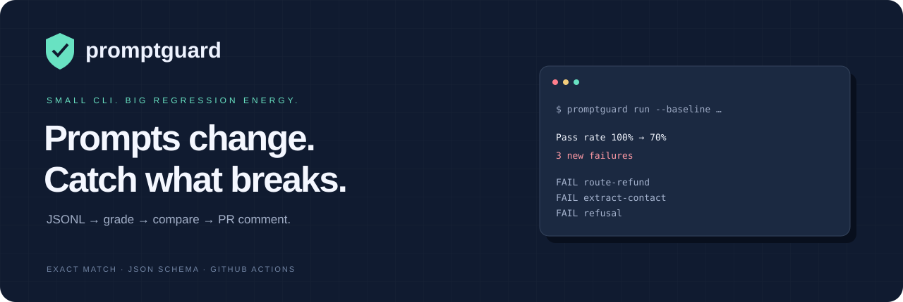
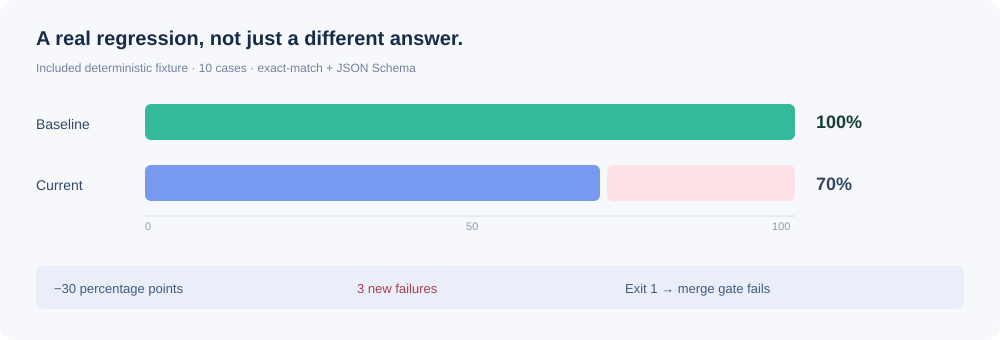
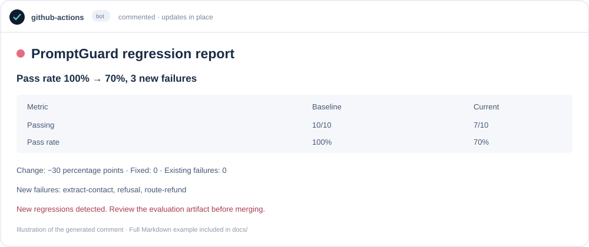
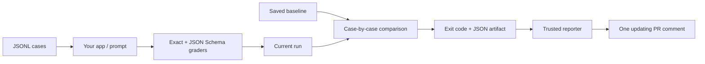

<p align="center"></p>
<h1 align="center">PromptGuard</h1>
<p align="center"><strong>Prompts change. Catch what breaks.</strong><br>A small regression eval harness for prompts and AI apps.</p>

<p align="center">
<a href="https://github.com/ArttuAn/promptguard/actions/workflows/eval.yml"></a>


<a href="LICENSE"></a>
</p>



**A prompt edit shouldn't quietly break yesterday's working cases.** PromptGuard runs a JSONL test set through your app, grades each output, and compares results against a checked-in baseline. GitHub Actions turns the diff into a visible merge signal and an updating PR comment.

[Quick start](#-quick-start) · [Test format](#-write-your-test-set) · [Adapters](#-connect-your-app-or-prompt) · [CI bot](#-the-pr-comment-bot) · [Limits](#-boundaries--security)

## ✦ The loop

| | Capability | Behavior |
|:--:|:--|:--|
| ▶ | **Run** | Sequential JSONL evaluation against your JavaScript app or an OpenAI prompt |
| ◎ | **Grade** | Strict exact match and JSON Schema, powered by Ajv + format checks |
| ◇ | **Baseline** | Save run artifacts and compare identical test sets by case ID |
| ↔ | **Diff** | Pass-rate change, new failures, fixed cases, existing failures |
| ⚑ | **Gate** | Any newly failing case exits `1`, even if other fixes hide the rate drop |
| ↗ | **Report** | JSON artifacts, Markdown, Actions summary, and one updating PR comment |

## 🚀 Quick start

Requires **Node.js 22+**. The included demo needs **no API key** and makes **no model calls**.

```bash
git clone https://github.com/ArttuAn/promptguard.git
cd promptguard
npm ci
npm test
npm run demo
```

```text
Passing: 10/10
Pass rate 100% → 100%, 0 new failures
```

Now run the intentionally broken adapter:

```bash
node bin/promptguard.js run \
  --cases examples/cases.jsonl \
  --adapter examples/regressed-app.mjs \
  --baseline examples/baseline.json \
  --out .promptguard/regressed.json \
  --report .promptguard/regression.json \
  --markdown .promptguard/report.md
```

```text
Passing: 7/10
  FAIL route-refund: Output did not exactly match the expected value.
  FAIL extract-contact: data must have required property 'email'
  FAIL refusal: Output did not exactly match the expected value.
Pass rate 100% → 70%, 3 new failures
```

**Exit code `1` is expected here.** This is the regression gate doing its job.



> The chart uses the real, deterministic 10-case example—not a model benchmark. No claimed accuracy score, no cherry-picked live model run.

Optional: `npm link` exposes the local **`promptguard`** command. This project is distributed through this Git repository; it is **not published to npm**.

## ◎ Write your test set

One JSON object per line. Blank lines are ignored. IDs must be unique and use letters, numbers, `.`, `_`, or `-` (maximum 100 characters).

```jsonl
{"id":"greeting","input":"Say hello","graders":[{"type":"exact","expected":"Hello!"}]}
{"id":"contact","input":"Extract Ada's email","graders":[{"type":"json-schema","schema":{"type":"object","required":["email"],"additionalProperties":false,"properties":{"email":{"type":"string","format":"email"}}}}]}
```

### Grading rules

- **`exact`**: text is case- and whitespace-sensitive. JSON values returned by an app adapter use deep structural equality; object key order doesn't matter. A string containing JSON is still a string for this grader.
- **`json-schema`**: accepts a JSON value or parses a string as JSON first. Invalid JSON fails. Uses **JSON Schema draft-07**, Ajv strict mode, and `ajv-formats`. No coercion, trimming, default insertion, or code-fence removal. Invalid/unsupported schemas are configuration errors.
- **Multiple graders**: a case passes only if **all** its graders pass.
- **Exceptions and timeouts**: the case fails and the run continues.

A schema checks shape, not truth. Add exact checks for concrete expectations or extend the grader when semantic quality matters.

## 🔌 Connect your app or prompt

### Option A — your JavaScript app

Create an ES module with one default-exported function:

```js
// my-app.mjs
export default async function respond(input, { id, signal }) {
  const response = await fetch('https://your-app.example/respond', {
    method: 'POST',
    signal,
    headers: { 'Content-Type': 'application/json' },
    body: JSON.stringify({ input })
  });
  if (!response.ok) throw new Error(`App failed: ${response.status}`);
  return response.json(); // Or return text. Use the value your grader expects.
}
```

```bash
node bin/promptguard.js run \
  --cases cases.jsonl --adapter my-app.mjs \
  --timeout 30000 --out .promptguard/run.json
```

Adapters can call your prompt chain, RAG app, local model, or API. They are executable code; run only adapters you trust.

### Option B — an OpenAI system prompt

```bash
# Set this locally. Never commit credentials or expose them to fork PRs.
export OPENAI_API_KEY='your-key-here'

node bin/promptguard.js run \
  --cases examples/cases.jsonl \
  --prompt examples/prompt.txt \
  --model gpt-4.1-mini \
  --out .promptguard/openai.json
```

Uses Chat Completions: the prompt is the system message and each case input becomes the user message. Provider text is graded as returned. `OPENAI_MODEL` can set the default model. Calls may incur charges; repeated live-model results can vary. The default CLI does **not** automatically load `.env`; export variables or use `node --env-file=.env bin/promptguard.js ...`.

The supplied CI uses the deterministic app adapter. It does not need secrets. Live OpenAI calls were not used to validate this project.

## ◇ Save and compare baselines

Create a baseline from a version you have reviewed:

```bash
node bin/promptguard.js run \
  --cases cases.jsonl --adapter my-app.mjs --out baseline.json
```

Then compare a later version:

```bash
node bin/promptguard.js run \
  --cases cases.jsonl --adapter my-app.mjs \
  --baseline baseline.json --out .promptguard/current.json \
  --report .promptguard/comparison.json --markdown .promptguard/report.md
```

Or compare two saved runs without inference:

```bash
node bin/promptguard.js compare \
  --baseline baseline.json --current .promptguard/current.json \
  --report .promptguard/comparison.json
```

### Regression semantics

- **New failure**: passed in baseline, fails now.
- **Fixed case**: failed in baseline, passes now.
- **Existing failure**: failed in both runs; reported, but not a new regression.
- **Pass rate**: passing cases / total cases. Changes use **percentage points**, not relative percentages.
- **Gate**: **any new failure** fails the comparison—even when fixes elsewhere keep the overall pass rate unchanged.
- **Comparable set**: test content (including graders) is fingerprinted; row order and JSON object key order do not matter. Changed inputs, graders, metadata, or IDs require an explicitly regenerated baseline. For `run --baseline`, compatibility is checked before inference.

| Exit | Meaning |
|:--:|:--|
| `0` | All cases pass without a baseline, or no new failures with one |
| `1` | Failing cases without a baseline, or new regressions with one |
| `2` | Configuration, dataset, artifact, or file error |

Baseline replacement is an intentional file update—not an automatic response to failure. Review baseline changes in pull requests. Provider/adapter errors are evaluated as failed cases, so an outage may produce exit `1` rather than `2`.

## 🤖 The PR comment bot



The complete generated Markdown is in [docs/example-pr-comment.md](docs/example-pr-comment.md).



Two workflows separate untrusted evaluation from the write-enabled reporter:

1. **[Prompt evaluation](.github/workflows/eval.yml)** runs tests and baseline comparison on pushes/PRs with read-only repository permissions. It uploads run/comparison artifacts even when the regression gate fails.
2. **[Evaluation PR comment](.github/workflows/comment.yml)** runs via `workflow_run`, checks out **only default-branch code**, downloads the triggering run's named artifact, validates the comparison data, and builds its own Markdown. It never executes an artifact or checks out PR code with a write token.
3. **[comment-pr.mjs](scripts/comment-pr.mjs)** creates or updates its own marked bot comment, links the evaluation run, and skips closed PRs or stale results.

### Enable it in another repo

- Copy the CLI/source, lockfile, examples, scripts, and both workflow files; run `npm ci`.
- Change the evaluation command to your own cases, adapter, and reviewed baseline.
- Merge the reporter workflow into the default branch first; `workflow_run` reporters must exist there.
- In repository **Settings → Actions → General**, allow GitHub Actions to create pull requests/comments as permitted by your organization. The reporter requires `pull-requests: write`.
- Open a PR that changes the app or prompt. Inspect the evaluation check, artifact, and bot comment.

Fork PR evaluation runs without secrets; a reporter can comment when GitHub associates the triggering run with a PR. If association is missing, the reporter deliberately skips commenting rather than guessing a PR. Configuration failures before a comparison is produced leave no comparison artifact and may cause the reporter download step to fail; inspect the evaluation log in that case.

## 🧪 Checks & project map

```bash
npm test        # 10 tests: graders, JSONL validation, errors/timeouts,
                # fingerprints, case-level diffs, safe reports, CLI exit codes
npm run demo    # Real local baseline comparison used by GitHub Actions
```

```text
bin/promptguard.js           CLI + optional OpenAI adapter
src/harness.js              JSONL loader, graders, runner, fingerprints, diffs
src/report.js               Validated summaries and Markdown
scripts/comment-pr.mjs      Trusted PR comment upsert
examples/                   Cases, working/broken apps, prompt, saved baseline
test/                       Unit and CLI integration tests
docs/                       Original SVG graphics and generated report
.github/workflows/          Evaluation gate + isolated comment reporter
```

## 🔒 Boundaries & security

- **Not a sandbox.** Adapters and schemas must be trusted. A timeout aborts cooperative I/O and marks a case failed; it cannot preempt a CPU-bound adapter or force cancellation of work that ignores its signal.
- **Artifacts contain model/app outputs and may contain sensitive data.** Don't commit real customer data; review logs and artifact retention. Adapter exception text is recorded, so adapters must avoid leaking secrets in error messages.
- **No automatic semantic grader**, LLM-as-judge, retries, statistical confidence, parallelism, or provider-independent prompt runner. Exact matching can be brittle for free-form responses.
- **Schema validity is not factual correctness or model safety.** The refusal example is a string regression test, not a comprehensive security evaluation.
- **PR data is untrusted.** The reporter validates report counts and IDs and renders only those fields. A contributor can still change a test, baseline, or workflow in their PR; evaluation results are not an attestation. Review those changes and configure branch protection yourself.
- Do not use `pull_request_target` to execute PR code. Never give untrusted adapters API keys or a write-enabled token.

## 🏷 Project signals

**Topics:** `llm-evaluation` · `prompt-engineering` · `regression-testing` · `json-schema` · `github-actions` · `cli` · `ai-testing`

**Labels:** `area:graders` · `area:ci` · `area:cli` · `area:docs` · `type:bug` · `type:feature` · `good first issue`

Ideas, not shipped features: repeated trials, custom grader plugins, parallelism, provider adapters, and richer trend history.

---
<p align="center"><br><strong>Ship the prompt. Keep the behavior.</strong><br><sub>MIT licensed · Small, inspectable, and built for regression checks.</sub></p>
